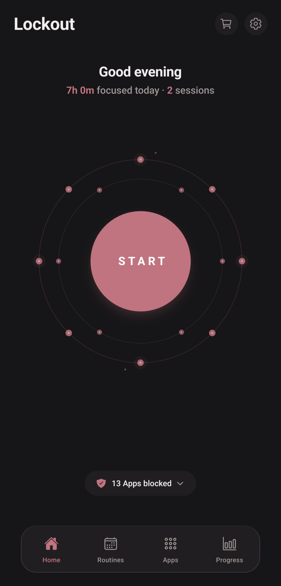
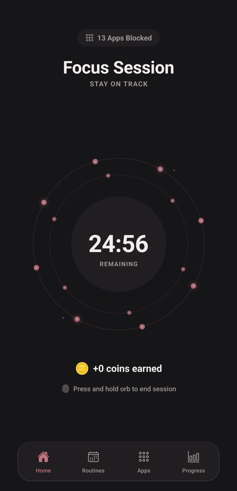
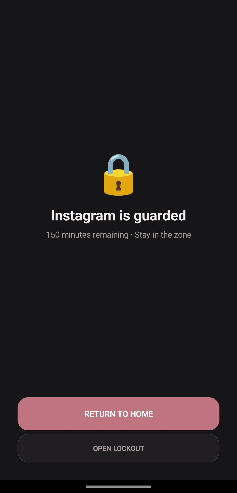
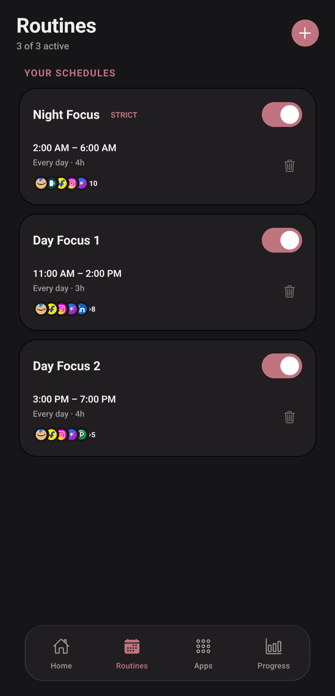
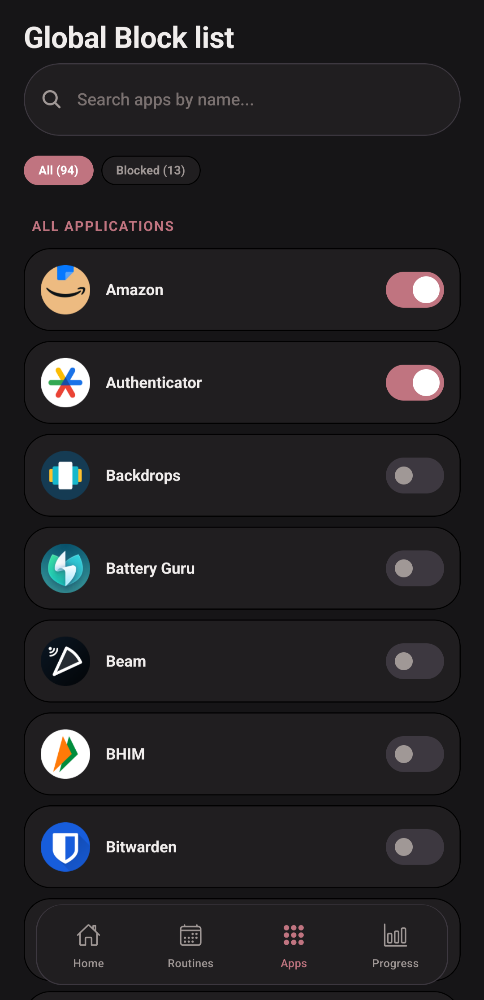
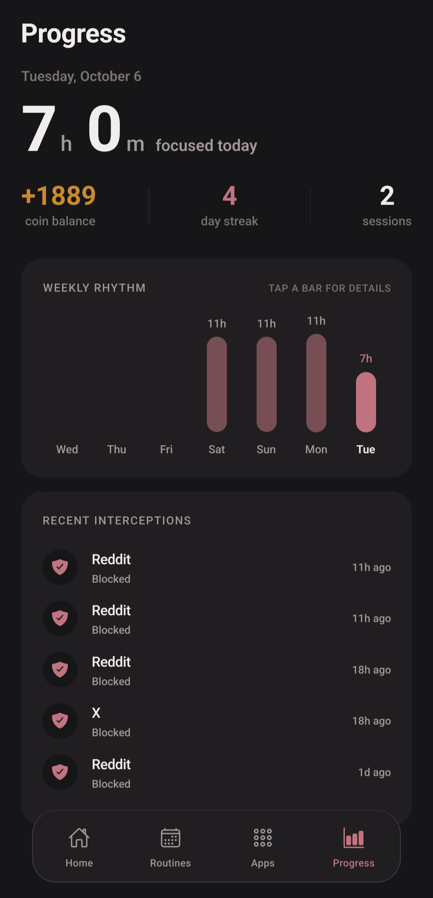
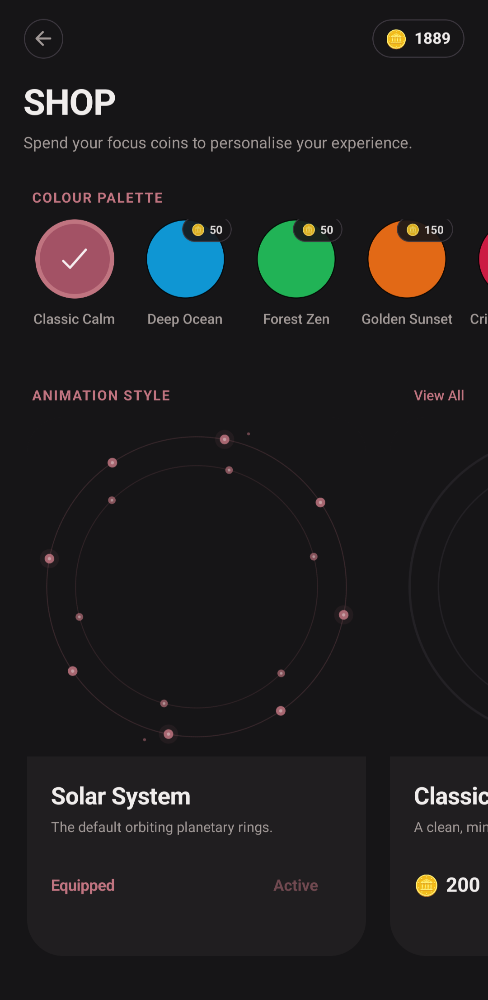

<div align="center">
  
  <h1>Lockout</h1>
  <p><strong>Lockout is a free and open-source Android app that blocks distracting apps while you focus. It works offline, tracks your focus time, and keeps your data strictly private on your device.</strong></p>

  <p>
    <a href="https://github.com/shubGupta10/focus-app/releases/latest">
      
    </a>
    &nbsp;
    <a href="https://apps.obtainium.imranr.dev/redirect?r=obtainium://add?url=https://github.com/shubGupta10/focus-app">
      
    </a>
    &nbsp;
    <a href="https://github.com/shubGupta10/focus-app/releases">
      
    </a>
    &nbsp;
    <a href="./LICENSE">
      
    </a>
  </p>
</div>

---

## 📱 Screenshots

<p align="center">
  
  
  
</p>
<p align="center">
  
  
  
</p>
<p align="center">
  
</p>

---

## 📥 Download

Get the latest build directly from GitHub Releases or manage automatic updates with Obtainium:

| Method | Source | Link | Updates |
| :--- | :--- | :---: | :---: |
| 🤖 **Direct Download** | Standalone `.apk` (Android 10+) | [**Download Latest APK**](https://github.com/shubGupta10/focus-app/releases/latest) | Manual |
| 🔄 **Obtainium** *(Recommended)* | Direct from GitHub | [**Add to Obtainium**](https://apps.obtainium.imranr.dev/redirect?r=obtainium://add?url=https://github.com/shubGupta10/focus-app) | **Automatic** |
| 📦 **Release Archive** | All `.apk` assets & changelogs | [**View Releases**](https://github.com/shubGupta10/focus-app/releases) | — |

> **💡 What is Obtainium?** [Obtainium](https://github.com/ImranR98/Obtainium) allows you to install and update open-source Android apps directly from their GitHub release pages, providing an app-store-like auto-update experience without Google Play.
> 
> **Note on Manual Installation:** If downloading the APK directly in your browser outside an app store, Android will ask you to allow **"Install unknown apps"**. This is standard for all open-source APKs.

---

## ✨ Features

- 🎯 **Focus Sessions**  
  Set a focus timer or use open-ended "Flow State" mode to track your focus time.

- 🛡️ **Native App Blocking**  
  Runs a background service with Android Usage Access to block apps on your blocklist while a session is running.

- ⏰ **Scheduled Routines**  
  Set recurring schedules that automatically start sessions and block apps at specific times.

- 🔒 **Strict Mode**  
  Prevents leaving or ending the session early until the timer finishes.

- 🪙 **Coin Rewards & Orb Themes**  
  Earn coins for completed focus minutes to unlock orb themes and background animations in the shop.

- 📊 **Statistics & Streaks**  
  View daily focus time, completed sessions, and streak counts.

---

## 🔒 Permissions & Security

Lockout requires specific Android system permissions strictly to perform app blocking and timer execution:

| Permission | Purpose |
| :--- | :--- |
| **Usage Access** (`PACKAGE_USAGE_STATS`) | Detects which app is currently in the foreground to trigger the blocker when a restricted app is launched. |
| **Display Over Other Apps** (`SYSTEM_ALERT_WINDOW`) | Draws the full-screen blocking overlay on top of restricted apps. |
| **Ignore Battery Optimizations** | Prevents Android from killing the background monitoring service during deep sleep or Doze mode. |
| **Alarms & Reminders** (`SCHEDULE_EXACT_ALARM`) | Ensures scheduled routines fire accurately down to the exact minute. |
| **Notifications** | Displays an ongoing foreground service notification showing remaining session time. |

---

## 🛡️ Privacy & Offline First

- **100% On-Device Data:** Focus session logs, streak histories, coin balances, routines, and app blocklists are stored entirely in a local SQLite database on your device.
- **Privacy-Preserving Telemetry:** Lockout uses [Aptabase](https://aptabase.com), an open-source analytics platform, strictly to collect high-level anonymous metrics (such as app opens and session completions). It never collects IP addresses, advertising IDs, or personal data.
- **Full User Control:** Anonymous telemetry can be turned on or off at any time during onboarding (Step 3) or inside Settings (*About & Support*).
- **No User Accounts:** No sign-up, email, passwords, or cloud sync required.
- **Core Features Work Offline:** Full blocking, timer tracking, and customization features function completely without an internet connection.

---

## 🛠️ Building from Source

### Prerequisites
- Node.js (v18+) & npm
- Android Studio with Android SDK (API 34+) and command-line tools
- JDK 17

### Development Setup

1. **Clone the repository:**
   ```bash
   git clone https://github.com/shubGupta10/focus-app.git
   cd focus-app
   ```

2. **Install dependencies:**
   ```bash
   npm install
   ```

3. **Run on an Android device or emulator:**
   ```bash
   npx expo prebuild --clean
   npm run android
   ```

---

## 🧱 Tech Stack

- **Framework:** [React Native](https://reactnative.dev/) (0.86) + [Expo](https://expo.dev/) (SDK 57)
- **Native Android:** Custom Kotlin Expo Module (`modules/focus-blocker`)
- **Styling:** NativeWind (Tailwind CSS v3)
- **Database:** Local SQLite via `expo-sqlite`
- **State Management:** Zustand
- **Animations:** React Native Reanimated

---

## 📄 License

This project is licensed under the GNU General Public License v3.0 - see the [LICENSE](./LICENSE) file for details.
